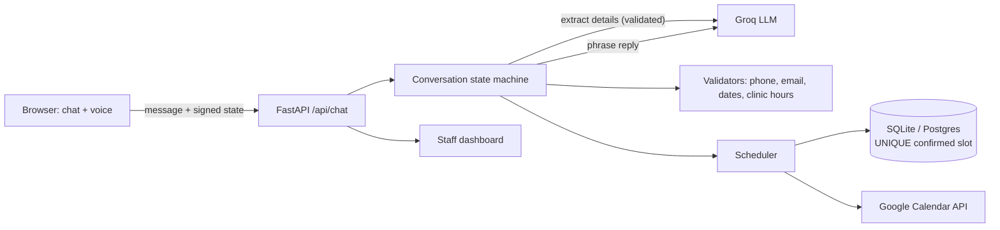

# BrightSmile Clinic: AI receptionist for a dental clinic

Aria is the virtual receptionist for *BrightSmile Clinic* (a fictional clinic). Patients can **chat** or **call** her. She greets them, collects their details, asks follow-up questions that fit their problem, flags emergencies, finds a free slot and books it into Google Calendar. The clinic team then sees every booking on a dashboard with an AI-written summary.

**Live demo:** https://smilebot-wine.vercel.app · **Staff dashboard:** https://smilebot-wine.vercel.app/dashboard.html (access code `demo`) · **Code:** https://github.com/Sidd1307/smilebot

## What it does

| Assignment requirement | How it's handled |
|---|---|
| Welcome message | Greeting that matches the time of day, plus quick-reply buttons |
| Data collection | Name, phone, email and reason for the visit, in **any order**, several in **one message** if the patient likes ("I'm Neha, 98111 22333, need a cleaning") |
| Follow-up questions | Depend on the reason. Tooth pain: pain score and swelling. Cosmetic or braces: which treatment. Child: age. Check-up: last visit. **Severe pain or swelling is flagged urgent** and the earliest slots are offered |
| Appointment scheduling | Understands natural language ("next Friday afternoon", "20/11 at 4pm"). Enforces clinic hours, the lunch break, Sunday closure and no past times. Offers the 3 nearest free slots |
| Confirmation | An appointment card the patient reviews first; any field can be changed ("actually my email is…") before confirming |
| Error handling | Invalid phone or email, typo domains ("gmial.com → did you mean gmail.com?"), gibberish, empty messages, off-topic questions. Hints get more specific on the second failure |
| Bonus: AI API | Groq (Llama 3, free tier) extracts details from free text and makes replies sound natural |
| Bonus: voice | "Call the clinic" opens a call-centre screen with speech-to-text and text-to-speech, live captions, a call timer, mute, and tap to interrupt |
| Bonus: calendar | Google Calendar free/busy checks and event creation. The patient gets an "Add to Google Calendar" link and an `.ics` file |

**Extras**
- **Staff dashboard:** every booking with an AI summary, sentiment, lead score (high-value / warm / browsing), urgency, suggested next step and the full transcript.
- **Reschedule and cancel:** by booking reference, after checking the phone number on file.
- **Conversation evals:** 15 messy scripted conversations, scored automatically (`scripts/eval.py`).

## How it's built



### Key design decisions

1. **Code owns the conversation, the LLM owns the wording.** A slot-filling state machine decides what's missing and when to confirm. The LLM only *proposes* extracted values, and every one is re-validated in code (phone format, email, real date within clinic hours). The LLM can't book an appointment, make up a time, or skip a required field.
2. **Works without AI.** With no API key, or if Groq is down or rate-limited, a regex + `dateparser` engine runs the same flow. Replies get plainer, but nothing breaks. Both paths are tested.
3. **Stateless server.** The conversation state travels with the browser as an **HMAC-signed** token, so patients can't tamper with it and any serverless instance can handle any message. No sticky sessions, nothing shared in memory.
4. **Concurrency.** All I/O is async. Independent work runs in parallel: at booking time, the calendar insert and the AI summary run together via `asyncio.gather`, and so do the DB and Google free/busy lookups. **Double-booking is prevented by the database**, using a partial `UNIQUE` index on confirmed slots, not by a check-then-insert in application code. When two patients confirm the same slot at the same moment, one gets it and the other is offered the nearest alternatives. This race is tested.
5. **Privacy.** Logs record the stage, latency and whether AI was used, but never patient details. The dashboard requires an access code. Messages are length-limited and requests are rate-limited.

## Run it locally

```bash
python -m venv .venv && .venv/Scripts/activate      # macOS/Linux: source .venv/bin/activate
pip install -r requirements-dev.txt
cp .env.example .env                                # add GROQ_API_KEY for AI mode (optional)
python -m uvicorn app:app --reload        # "python -m" also works where Windows blocks pip-installed .exe launchers
```
Open http://127.0.0.1:8000. Voice calls need Chrome, Edge or Safari.

## Tests

```bash
pytest                                  # 100+ unit/integration tests (flow, validators, DB race, LLM mocks, calendar mocks)
python scripts/eval.py                  # 15 messy end-to-end conversations, rules engine
python scripts/eval.py --ai             # same, with Groq
python scripts/ui_smoke.py http://127.0.0.1:8000   # real browser: full booking + mobile + dashboard
```

## Deploy (Vercel)

1. `vercel` (FastAPI is detected automatically from `app.py`; the frontend in `web/` is served by FastAPI).
2. Set the environment variables from `.env.example`. Use **Postgres** for `DATABASE_URL` (e.g. Neon's free tier via the Vercel Marketplace), because Vercel's filesystem is temporary.
3. Google Calendar: create a service account → share a test calendar with its email ("Make changes to events") → set `GOOGLE_SERVICE_ACCOUNT_JSON` and `GOOGLE_CALENDAR_ID`.

## Known limits

- Service accounts can't send calendar invites to patients without Google Workspace domain-wide delegation, so patients get an add-to-calendar link instead.
- Browser speech recognition quality varies by browser. A production call centre would use telephony (e.g. Twilio) with server-side speech-to-text.
- The rate limiter runs per instance; a fleet would need a shared store such as Redis or Upstash.
